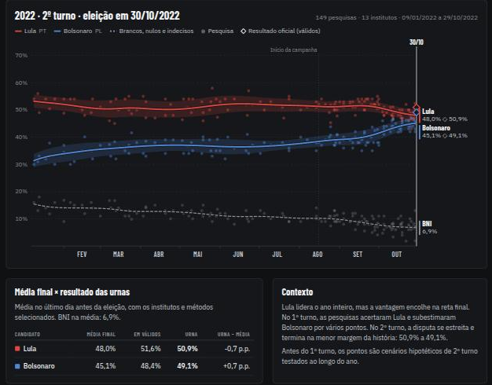
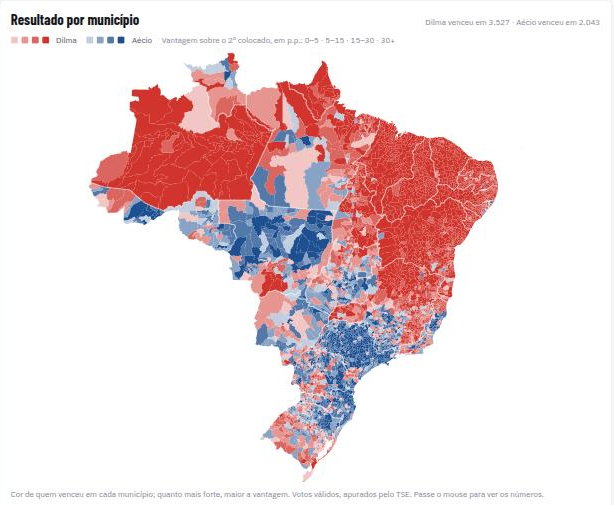
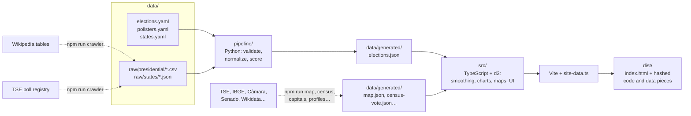

# Urna: Brazilian election poll tracker

[](https://github.com/danillog/urna/actions/workflows/ci.yml)

Every published poll for Brazil's presidential, governor and Senate races, a smoothed average per candidate, and a ranking of which pollsters got closest to the official result. Around it: the live count, Congress since 1990, who was elected in 2026, the vote against the census in every municipality and inside the 27 capitals, who lives where inside each capital, and the politics of the Americas. It is a static site: the polls load with the page, and each tab downloads its own data when it opens.

**Live:** [danillogomes.com/urna](https://danillogomes.com/urna/) · The page is in Portuguese; code and docs are in English.



## Features

- **Made for people who are not specialists.** A home page of plain questions ("Who spends the most of their office allowance?", "Do richer cities vote differently?") that open the right tab with the right options, and a short glossary of the words the site uses (valid votes, runoff, electoral quotient, alternate, office allowance, Centrão, government base). Tabs in three named groups (Eleição 2026, Políticos, Mapas e dados), a row of ready-made questions at the top of each tab, secondary options folded away on phones, and links between a member's profile and their spending and attendance.
- **Nearly 1,400 polls**: president 2010–2026 (both rounds), plus 2026 governor and Senate races in all 27 states.
- **Live re-averaging.** Turn pollsters or interview methods (in person, phone, online) on and off, and the trend lines are recomputed in the browser.
- **Polls vs. ballot box.** For past elections, the final average is converted to valid votes and compared with the official TSE result.
- **Map tab: 30 years of results by municipality.** All 5,570 municipalities for every presidential round since 1994 (2026 included) and every mayor election since 1996. Press play to watch the map change election by election, click a party to follow it through time (say, where the PT won city halls from 1996 to 2024), and zoom in down to single municipalities: pick a state, use the +/− buttons, pinch, or ctrl/⌘ + scroll.
- **Americas tab.** Every country of the Americas since 2000, colored by the ideological family of whoever won its latest national election (president, or the governing party in parliamentary systems). Press play to watch left and right waves cross the continent. Where sources have them, states and provinces show their local winner (72 of 210 elections, including the US, Canada, Mexico, Brazil, Argentina, Colombia and Chile). The same map can switch to the Human Development Index (UNDP; Brazil by state, from the Atlas of Human Development), purchasing power (median income per person from household surveys, PPP, World Bank PIP) and electoral democracy (V-Dem). The Brazil map tab also shows the municipal HDI of the 1991, 2000 and 2010 censuses.
- **Programas tab: which program do you agree with more?** The 2026 runoff candidates' government programs, as registered with the TSE, made into cards without their author: agree, disagree or skip, then see whose each proposal was, how close you came to each program (overall and theme by theme) and the page of the PDF where it is written. The same number of cards for each candidate in every theme, shown in turns so a run cannot give the author away; what both programs propose is listed apart; vice, parties and each candidate's own profiles come from the TSE's files. Every quote is checked, word for word, against the page it cites (see [Data pipelines](#data-pipelines)). Answers never leave the browser. Apart from the quiz, promises made in the TV debates that are not in the programs, as said, with a link to the minute of the network's own video, balanced theme by theme.
- **Apuração tab: the live count.** President, governor, senator and deputies as the TSE counts them, by state and by municipality, with seats projected by the law's rules and the deputies who rode in on their list's votes marked; who chose no one (null and blank votes, abstention) in people beside the bars, and the map painted by any of the three, by state or by municipality (see [Live count](#live-count-apuração)).
- **Congresso tab: the Chamber and the Senate since 1990, and São Paulo's state assembly (Alesp, 2010 on) and city council (2012 on).** A hemicycle per election, parties placed left to right by academic estimates that change over time (Zucco & Power; Bolognesi et al.), the Centrão marked from a cited list, the government's base and the Centrão as measured by votes, the seats of 2026's newcomers, the legislature in office by party as elected and as today (who switched party), every member placed left to right by their own roll-call votes, and a modal per party: its names over time, seats, place on the scale and how often it voted with each government (Chamber since 2003, Senate since 2019).
- **Eleitos 2026 tab.** Everyone elected in 2026 (governors, senators, federal deputies): where they came from (first-timers, career politicians, appointed office holders), every candidacy since 2010, offices, social networks, contact and recent news. Renewal by office, party and state, and those in Congress who ran in 2026 and lost. For those in Congress now, the current term: presence in roll-call votes, votes with the government, position by their votes, every vote on a constitutional amendment or complementary law, committees, rapporteurships, speeches, bills and how many became law, and the parliamentary allowance against their state's median. Social networks as declared to the TSE. Criminal cases appear only when checked by hand on the court's own page (see [Criminal cases](#criminal-cases)).
- **De olho tab: who spends and who shows up.** Federal deputies, senators, São Paulo's state deputies (Alesp) and São Paulo's city councillors, each house with four top-10 lists anyone can read: who spent the most of their office allowance, who spent the least, who attended the least and who attended the most. Plus a search by name and one card per member against the house's typical value. Spending is per month in office (in the Chamber, as a share of the member's own state's ceiling, which differs by state); presence counts only the time in office, so leave (to be a minister, say) is not counted as absence. Each house says exactly what it counts: Chamber, deliberative plenary sessions; Senate, plenary roll calls excluding justified absences; Alesp, its permanent committees' meetings (the only presence it publishes as open data); city council, plenary sessions. It does not rank "work", which no house records.
- **Voto e Censo tab.** The PT's candidate and the strongest rival in every municipality from 1994 to 2026, against income, religion, schooling, urbanization and size from the 1991–2022 censuses, and inside the 27 capitals, area by area, with the 2026 ballot boxes placed in the 2022 Census weighting areas. Both rounds where there was a runoff; inequality (Gini, 1991–2010); the capitals against the rest of the country. Inside the capitals there is also colour or race (every person, from the census tracts) and the share of couple households with a same-sex couple, the only census figure near the subject: the census does not ask sexual orientation or gender identity, and the page says so. Nineteen capitals can also be seen by the IBGE's neighbourhoods, and São Paulo by its 96 districts and 32 subprefeituras. Religion and schooling are shown as whole distributions, not averages, and a joint fit shows what is left of each pattern with the others held equal.
- **Quem mora onde tab.** One census figure at a time inside a capital, over a street map (OpenStreetMap tiles): the elderly (60+), Black people (preto and pardo), same-sex couples, mean and median income, schooling, religion and colour or race, from the 2022 census tracts and weighting areas. A ranked list beside the map (the ten with most, the whole city, the ten with least) and a card per place with every figure next to the city's. Each capital opens at its most familiar names: São Paulo's 96 districts, the IBGE's neighbourhoods (19 capitals) or regions (the IBGE's subdistricts, 15 capitals, Brasília's regiões administrativas among them). São Paulo has no official neighbourhoods, so the IBGE has none there: its approximate neighbourhoods come from OpenStreetMap's points, each census tract going to the nearest one in its own district, and the page says so.
- **Pollster accuracy.** Each pollster's last poll before election day is scored. For the current election, the table shows each pollster's track record since 2010.
- **Shareable views.** The selection lives in the URL, e.g. [`?office=governor&uf=SP`](https://danillogomes.com/urna/?office=governor&uf=SP) or [`?year=2022&exclude=Gerp,Palver`](https://danillogomes.com/urna/?year=2022&exclude=Gerp,Palver).
- **Share as an image.** Every chart and map can be shared (or downloaded) as a PNG card with its title and source.
- **Accessible and themable.** Keyboard navigation (maps too: + and − zoom, arrows pan, 0 resets), data tables (the polls, and the map as a table by state or municipality), colorblind-safe palette, and a light/dark switch (automatic by default, the choice remembered in the browser).



**Live links:** [mayors elected in 2024](https://danillogomes.com/urna/?view=map&office=mayor&year=2024) · [the PT's city halls since 1996](https://danillogomes.com/urna/?view=map&office=mayor&year=1996&focus=PT) · [2002 runoff](https://danillogomes.com/urna/?view=map&office=president&year=2002&round=r2) · [Rio de Janeiro's mayors in 2024](https://danillogomes.com/urna/?view=map&office=mayor&year=2024&uf=RJ)

## How it works



| Layer | Stack | Responsibility |
|---|---|---|
| `data/` | YAML, CSV, JSON | The only source of truth: polls, dates, results, parties, colors, events, context. |
| `pipeline/` | Python 3.11, PyYAML | Validates every poll (dates, duplicates, rounding-aware sums), normalizes pollster names, scores accuracy, writes `elections.json`. |
| `src/` | TypeScript, d3 modules | Smoothing, state and URL sync, chart and tables. Copy lives in `src/i18n/pt-BR.ts`. |
| build | Vite + `site-data.ts` | Splits the generated data into pieces, each a chunk with a content hash: the page opens with the code and the polls (about 0.5 MB, 140 KB gzipped), and each tab downloads its own data when it opens. See [Build and deploy](#build-and-deploy). |

The generated dataset is committed. The web app builds without Python, and CI fails if the dataset is stale.

## Methodology

**Trend line.** Each day gets a local linear regression over nearby polls, weighted with a Gaussian kernel. The bandwidth is 14 days over an election year, 4 days for the short presidential runoff campaign and 10 days for state runoffs. A local linear fit, unlike a moving average, does not lag behind a trend.

**Weights.**
- A poll's weight grows with the square root of its sample size, clamped to 500–5,000 interviews.
- A pollster that publishes several rounds within 7 days (daily trackers) has its weight divided by the square root of that count, so it cannot dominate the average.
- Optionally ("Média: Pelo histórico", `?peso=historico`), each pollster is also weighted by its margin error in the final poll of the presidential rounds held before the race shown: everyone's average error over the pollster's own, the latter shrunk toward the former as if it had two more rounds at that average, clamped to 0.5–2. A pollster with no record gets 1.

**Band.** ±1 weighted standard deviation of the polls around the line.

**Few polls.** With fewer than 3 polls, the line only connects the daily means.

**Past misses.** While a presidential race has no result, a table applies to today's margin between the two leaders (in valid votes) the miss of the final average on the top two's margin in the same round of every earlier election and, for a runoff, in this election's 1st round. Each miss is applied both ways, since its direction cannot be known in advance, and the candidate it underestimated is shown as a fact. It is not a forecast or a probability: there are only a handful of elections, and pollsters change their methods after each miss.

**Accuracy.** Each pollster is scored on its last poll with fieldwork ending within 10 days before the election. Poll and result are both rescaled to shares of the candidates in the result. That puts total-vote polls and the valid-vote result on the same footing. Two measures:
- *Mean error*: the average absolute gap, in points.
- *Margin error*: the error on the gap between the top two.

**Data rules.**
- Dates are the last day of fieldwork.
- Values are total votes in the prompted scenario.
- *BNI* (blank, null, undecided) is shown as its own dashed line.
- First-round polls published only as valid votes are left out, because they are on a different scale.

## Getting started

Requirements: Node 20+ and [uv](https://docs.astral.sh/uv/) (Python is only needed to change data).

```bash
npm install
npm run dev          # http://localhost:5180
npm run build        # → dist/: index.html, assets/ and og.png, ready to upload
```

```bash
uv sync
npm run data         # rebuild data/generated/elections.json
npm run check        # typecheck, tests, lint, dataset freshness
```

| Script | What it does |
|---|---|
| `npm run dev` | Dev server with hot reload |
| `npm run build` | Typecheck and build `dist/` |
| `npm test` / `npm run test:data` | Vitest (web) / pytest (pipeline) |
| `npm run check` | Everything CI runs |

The data scripts are listed in [Data pipelines](#data-pipelines).

### Build and deploy

`npm run build` writes `dist/index.html`, `dist/assets/` and `dist/og.png`. Upload the whole folder: the page loads its scripts and data from `assets/` with relative paths, so it works under any path (it is served at `/urna/`). File names carry a content hash, so `assets/` can be cached forever; only `index.html` should be revalidated.

`npm run deploy` builds and sends `dist/` to Hostinger with `rsync --delete` (only what changed), into `public_html/urna/`: https://danillogomes.com/urna/. The SSH settings go in `.env.deploy` (copy `.env.deploy.example`; hPanel → Advanced → SSH Access), which stays out of git, and the script refuses a path that does not end in `/urna/`. `public/.htaccess` sets the caching: hashed files for a year, `index.html` always revalidated.

What each visit downloads (gzipped, October 2026):

| Opening | Downloads |
|---|---|
| any page | code + all polls, ≈ 140 KB |
| Mapa | municipal mesh, names and HDI ≈ 400 KB, then ≈ 35–85 KB per election shown |
| Voto e Censo | the mesh (shared with the map) + census and votes ≈ 735 KB, then ≈ 1–170 KB per capital |
| Quem mora onde | the list of capitals (under 1 KB), then ≈ 1–170 KB per capital (São Paulo, with its districts and neighbourhoods, the largest), plus the street map's tiles from OpenStreetMap |
| Eleitos 2026 | the list ≈ 90 KB, then the news of a state when one of its profiles opens, and the current term in Congress (≈ 30 KB) with the first profile |
| Congresso, Apuração, Américas | ≈ 5 KB, ≈ 120 KB + the mesh, ≈ 90 KB |

`site-data.ts` (a Vite plugin) does the split: every piece is a virtual module, `virtual:site-data/<name>`, and `src/data.ts` loads them with `import()`. The same code runs in `vite dev`, in Vitest and in the build, with no extra build step and no files to keep in sync. The pieces: `map` and `map-race/<key>`; `capitals` and `capital/<IBGE code>` (each capital with only the part of the mesh it uses); `profiles` and `profiles-news/<UF>`; and one piece per other generated file.

## Data pipelines

Every dataset under `data/generated/` is built by a script in `pipeline/` and committed, so the site builds with Node alone. The scripts download what they need into `data/raw/` and cache it; the large or personal caches (`tse/`, `ibge/`, `capitals/`, `profiles/`, `camara/`) stay out of git. Run them with `uv run python -m pipeline.<name>`, or through the npm script where there is one.

| Command | What it builds, from what | Why it exists | Run again when |
|---|---|---|---|
| `npm run data` (`pipeline.build`) | `elections.json`: every poll, validated and normalized, with results and pollster scores, from `data/*.yaml` and `data/raw/presidential`, `data/raw/states`, `data/raw/results` | The polls tab; the only source of truth for polls is in `data/` | after any poll or YAML change (CI fails if it is stale) |
| `npm run crawler` (`pipeline.crawl`) | appends new polls to `data/raw/`, from Wikipedia tables and the TSE poll registry, then rebuilds `elections.json` | Finding polls by hand misses some; the registry tells what is still missing | during a campaign, every few days |
| `npm run refresh` (`pipeline.refresh`, `-- --all` for the heavy steps) | every pipeline below that has something new, in order; a step waiting on the TSE (the runoff before it is listed) is reported as waiting | One command for election night and for the scheduled run (`.github/workflows/refresh.yml`, every 6 hours; it commits only with the repository variable `AUTO_COMMIT=true`) | whenever a source may have changed |
| `pipeline.results` (`r2` for the runoff) | `data/raw/results/2026-r1.json`, `2026-r2.json`: the official result per race, from the TSE's results site | Ranks the pollsters by how close they got; keeps a copy so the build does not depend on the TSE's site | once the count ends |
| `npm run map` (`pipeline.fetch_tse_results` + `pipeline.municipal_map`) | `map.json`: president 1994–2026 and mayor 1996–2024 per municipality, the IBGE mesh (simplified with mapshaper) and municipal HDI, from TSE open data, IBGE and Ipeadata | The Mapa tab | after an election, once the TSE publishes it (see [Municipality map](#municipality-map)) |
| `pipeline.idhm_census` | an estimate of the 2022 municipal HDI from Census 2022 tables (SIDRA), used by `municipal_map` | The Atlas has not published the 2022 IDHM by municipality | when IBGE revises the tables; drop it once the official IDHM is out |
| `npm run americas` | `americas.json`, `americas.topo.json`, `americas-indicators.json`, from Wikipedia, Natural Earth, UNDP, World Bank, FAO, USDA, IBGE, V-Dem, Ipeadata and the US Census Bureau | The Américas tab | after an election in the Americas, or yearly for the indicators |
| `npm run apuracao:cidades` (`-- r2` for the runoff; `--year 2024 --out …` for a rehearsal) | `apuracao-cidades.json`: the count per municipality, with null and blank votes and abstention, from the TSE's results site (5,570 files per office; a file that fails is asked once more) | The Worker cannot read 5,570 files per request (free plan: 50), so the page ships a snapshot | during the count, then once at 100% |
| `pipeline.congress` (`--refresh-2026` new delegations, `--refresh-now` parties today and switches, `--refresh-sp` Alesp and city council) | `congress.json`: seats per party in the Chamber since 1990 and the Senate since 2002, with each party's place left to right, from `data/congress.yaml`, Zucco & Power and Bolognesi et al., the TSE and the Senate's open data | The Congresso tab | after an election, or when a new wave of the studies comes out |
| `pipeline.governismo` | `governismo.json`: how often each party's leader oriented with the government's in contested plenary votes, per presidential term, from the Câmara's open data (2003 on) and the Senate's (2019 on, when its orientations begin) | The party modal and the measured base in the hemicycle: base, independent or opposition, measured instead of asserted | every few months, or at the end of a term |
| `pipeline.watch` | `watch.json`: allowance spent per month in office and attendance for the Chamber (CEAP, plenary sessions), Senate (CEAPS, roll calls), Alesp (verba de gabinete, committee meetings) and São Paulo's city council (SisGV, SPLegis plenary presence) | De olho tab | with `pipeline.mandate` (uses its Câmara and Senate caches) |
| `pipeline.ideology` | `ideology.json`: every member of Congress placed left to right by their contested roll-call votes this term (first principal component), checked against Zucco & Power (r ≈ 0.8) | Positions measured on people, not parties | with `pipeline.mandate` |
| `pipeline.mandate` | `mandate.json`: for the elected who sit in Congress now, presence in plenary roll calls, votes with the government, bills as first author (passed, became law) and the parliamentary allowance (CEAP, CEAPS), from the Câmara's bulk files and the Senate's API | The profile's "current term": what they did, with what to read it against (no "hours worked": there is no such record) | monthly |
| `pipeline.legal` (`--checklist` for the private list) | adds to `profiles.json` the criminal cases in `data/legal.yaml`, validated; the checklist links each deputy and senator to the STF's search | See [Criminal cases](#criminal-cases) | after each review |
| `pipeline.programs` | `programs.json`: the cards of the Programas tab, from `data/programs.yaml` (written by hand) and the two programs registered with the TSE (`public/programas/*.pdf`, their SHA-256 in the YAML), read with `pdftotext` (poppler-utils) | Refuses a quote that is not on the page it cites, a theme with more cards for one side, or a profile link the candidate did not declare to the TSE (when `pipeline.profiles`'s cache is here) | after any change to `data/programs.yaml` |
| `npm run profiles` (`pipeline.profiles`) | `profiles.json`: everyone elected in 2026, their candidacies since 2010 and their contacts, from TSE candidate files 2010–2026 and the Câmara's and Senate's open data | The Eleitos 2026 tab; candidacies are linked by voter registration, which is never written out | after the TSE publishes the elected deputies, and after the runoff |
| `pipeline.profiles_web` (`--no-news` for Wikidata only) | adds appointed offices, social networks and the Wikipedia article (Wikidata, matched by name and birth date) and recent headlines (Google News) to `profiles.json` | The TSE does not record appointed offices or social networks | after `pipeline.profiles`; news weekly |
| `npm run census` (`pipeline.census_vote`) | `census-vote.json`: the PT's candidate and the main rival in every municipality, 1994–2026, next to the 1991–2022 censuses (income, religion, schooling, urbanization, population), from Ipeadata (Atlas), SIDRA and the TSE | The Voto e Censo tab | after a new election or census table |
| `npm run capitals` (`pipeline.capitals`, one capital by IBGE code, or `r2` for the runoff) | `capitals.json`: the 2026 vote in each of the 1,472 weighting areas of the 27 capitals, from IBGE tracts and sample results, TSE polling places and every ballot-box report; colour or race, age (60+) and same-sex couples summed from the census tracts; mean and median income per person; the IBGE's neighbourhoods and subdistricts (regions) where they cover the city; São Paulo by district and subprefeitura (`data/sp_subprefeituras.yaml`, from the city's own list) and by approximate neighbourhood (OpenStreetMap points via Overpass, cached in `data/raw/capitals/osm_sp_bairros.json`: delete it to fetch them again); the runoff beside the 1st round | The vote inside the capitals: the municipality is too large a unit there | after each round's reports are published |
| Worker (`worker/`) | the live count, served to the Apuração tab | The TSE's results files cannot be read by other sites (no CORS) | deploy once before an election day |

### Finding new polls

```bash
npm run crawler              # add new presidential, governor and Senate polls, report what is still missing
npm run crawler -- --dry-run # report only
git diff data/raw            # review what was added
```

The crawler reads two sources. Each covers what the other cannot:

| Source | What it gives | What the crawler does with it |
|---|---|---|
| [Wikipedia poll tables](https://en.wikipedia.org/wiki/Opinion_polling_for_the_2026_Brazilian_presidential_election) | The numbers, for presidential polls | Appends polls that are missing from the CSVs and flags polls whose numbers disagree with the dataset. |
| Portuguese Wikipedia state pages ([São Paulo](https://pt.wikipedia.org/wiki/Pesquisas_eleitorais_para_a_eleição_estadual_de_2026_em_São_Paulo), …) | The numbers, for governor and Senate polls | Appends polls newer than the latest one of each race to `data/raw/states/<UF>.json`, and flags disagreements. |
| [TSE poll registry](https://dadosabertos.tse.jus.br/dataset/pesquisas-eleitorais-2026) | Every registered poll (pollster, dates, sample), updated daily, but not the results | Confirms each new poll and lists published polls that are still missing, national and per state. |

A Wikipedia poll is added only when:
- **it is confirmed:** the TSE registry has a matching registration, or its pollster already has polls in that race;
- **it is unambiguous:** one scenario matches the race (for a runoff, exactly the two candidates), and there is a blank/null/undecided column, since a poll without one may be valid votes only.

For governor and Senate polls, also:
- **it is newer than the race's latest poll:** older polls missing from a file may have been left out on purpose, so they are only counted;
- **it is the race we follow:** every candidate above 5% in our latest poll is in the scenario, a runoff poll tests the file's `matchup`, and a Senate poll adds up to about 100% (the raw sum of two votes is on another scale);
- **it comes from a pollster we follow** (`data/pollsters.yaml`) or one that already polls that state, not a local institute.

Everything else is listed for a human to check. Polls rejected on purpose go in `skip_polls` in `data/elections.yaml` (president) or `excluded_polls` in `data/states.yaml` (states), so they are not proposed again. When a page names a candidate in a way the crawler cannot match, map it in the race's `wikipedia` field (see [the spec](data/raw/states/SPEC.md)).

### Adding a poll by hand

1. **President:** add a row to `data/raw/presidential/<year>-<round>.csv`:
   ```csv
   pollster,date,sample_size,Lula,Flávio,Cury,others,undecided
   Datafolha,2026-10-03,2506,42,38,4,,7
   ```
   In 2026 round 1, a blank `others` is derived as 100 minus everything else.
2. **Governor or Senate:** add a line to `data/raw/states/<UF>.json`, following [the spec](data/raw/states/SPEC.md).
3. Run `npm run data`. Validation errors name the file and the poll at fault.

A new pollster's alias and interview method go in `data/pollsters.yaml`. A new election goes in `data/elections.yaml`.

### Municipality map

`npm run map` downloads the TSE results per municipality and the IBGE boundaries (TopoJSON, minimum quality), then writes `data/generated/map.json`. It covers president from 1994 and mayor from 1996; 1989 has no per-municipality file in TSE open data.

- **2026.** The open-data archive published the day after the 1st round came with the presidential file empty. When that happens, `fetch_tse_results` reads the president's votes from the TSE's results site instead, municipality by municipality, and only once every one is fully counted; the map says so and cites that source. Running `npm run map` again after the archive is complete switches back to open data.

- **Matching municipalities.** TSE and IBGE number municipalities differently, so codes are matched by state and name, ignoring accents and punctuation. The 12 names that differ, such as renamed towns or spellings like *Santa Isabel / Santa Izabel do Pará*, are pinned in `data/municipalities.yaml`. All 5,570 municipalities match. Those created after an election show as "no result".
- **Checked against official totals.** National totals reproduce the official presidential results in every round from 1994 to 2022.
- **Votes counted.** Shares are of valid votes cast in Brazil; votes cast abroad are left out.
- **Mayors.** Each municipality shows the candidate the TSE marks as elected, which is not always the most voted (ties go to the older candidate, and annulled candidacies don't count). Where there was a runoff, its result is used. The current TSE files already include court decisions and supplementary elections, so counts can differ slightly from what was reported on election night.
- **Party colors** come from `data/parties.yaml`. A party keeps its color through renames (PFL → DEM → União, PMDB → MDB, PPR → PPB → PP, PR → PL, PRB → Republicanos), so the timeline shows continuity. Mergers don't carry a color over. Parties without a lineage there are gray.
- **Storage.** Per-municipality numbers are stored as base64 typed arrays, each election in its own piece.
- **Mesh.** The IBGE mesh goes through mapshaper: 75% of its points and a 40,000-step grid. At state zoom it looks the same as the original; at the deepest zoom some small corners are lost. Lower settings turned small towns into polygons.

### Americas

The data comes from three steps, and each one can be checked on its own.

- **Elections:** `pipeline/americas/discover.py` lists each country's national election articles on English Wikipedia (210 elections, 2000 onwards). It reads who took office (`after_election`) from the infobox. The first-listed candidate is not used: it can be a first-round leader who then withdrew, as Menem did in Argentina in 2003. Hand fixes live in `data/americas/corrections.yaml`, each with its reason.
- **Families:** `data/americas/parties.yaml` places every winning party in one of four bands of the [Global Party Survey 2019](https://www.globalpartysurvey.org/) economic left–right scale (Norris, CC0): left < 2.5 ≤ centre-left < 5 ≤ centre-right < 7.5 ≤ right.
  - The survey is used only for countries rated by at least 5 experts.
  - Otherwise the party's Wikipedia `position` is mapped to the same bands.
  - Five ambiguous parties are decided by hand, each with a note.
  - The source of each party's family shows on hover.
- **Results by state/province:** `pipeline/americas/regions.py` reads the "results by state" tables of each article, or of its Spanish version, matching rows to regions (aliases in `data/americas/regions.yaml`). A table is accepted only when, summed over regions, the national winner comes first (or within 2%, for races decided abroad). Canada's transposed tables have their own reader. Brazil comes from the TSE.
- **Indicators:** `pipeline/americas/indicators.py` takes:
  - HDI from the UNDP 2025 time series (UNDP's tiers in the tooltip);
  - median income per person from household surveys, from the World Bank Poverty and Inequality Platform (2021 PPP $ per month; income surveys only, nothing older than 4 years);
  - poverty at US$ 8.30 a day (2021 PPP), same platform and surveys. Where a country has no recent income survey, its latest survey of any kind (consumption included, as the World Bank itself does) is shown faded, up to 10 years old; countries with nothing usable stay blank and the tooltip says why (no survey at all, or the last one too old: Venezuela 2006, Haiti 2012, Nicaragua 2014). The US states' tooltip adds the Census Bureau's official rate (SAIPE), which uses the much higher US line: the map's color stays the World Bank's national figure;
  - food insecurity: FAO's prevalence of moderate or severe food insecurity in the population (FIES, SDG 2.1.2), FAOSTAT's 3-year averages placed at their middle year (2022–2024 shows in 2023), from 2015; FAO does not publish Venezuela, Nicaragua or Panama and has nothing for Cuba, and the tooltip says so. Tooltip only, each on its own scale (households, not FAO's): the US states from the USDA's last Household Food Security report (2024, released December 2025; 2012–14, 2019–21 and 2022–24 averages, read from its PDF with `pdftotext`, poppler-utils; the USDA ended the series after it), and Brazil's states from IBGE's EBIA (PNAD 2004, PNAD Contínua 2023 and 2024, SIDRA tables 3017 and 9552; Brazil's own 2004–2024 series from table 6665);
  - V-Dem's electoral democracy index via Our World in Data;
  - Brazil's IDHM by state (yearly since 2012) and by municipality (1991, 2000, 2010 censuses), Atlas of Human Development in Brazil (PNUD, Ipea, FJP) via the Ipeadata API.
  - Municipal IDHM 2022: **our own estimate**, not an official figure (`pipeline/idhm_census.py`). The Atlas has not published the 2022 Census IDHM by municipality yet, so it is computed from IBGE's Census 2022 tables (SIDRA API) with the Atlas method: income per person deflated by the INPC; adult schooling and school attendance by age; longevity from the share of children who died (pulled toward the state's share where births are few) and income. The approximations are fitted on the 2010 Census, where the same calculation lands within 0.006 of the official IDHM on average; each state's level is then set to its official 2022 IDHM.
  - Each is shown in ten fine steps of the viridis palette: with wide bands, real changes stayed one color (Brazil's democracy index going from 0.69 in 2022 to 0.79 in 2023).
- **Boundaries:** Natural Earth admin-1, simplified with mapshaper.

Cuba (no competitive elections), annulled elections and dependent territories are gray. Venezuela 2024 shows the official result, flagged as disputed.

## Criminal cases

A mark on a profile for someone under investigation or convicted is the riskiest thing the site can say, so it is never automatic:

- **No source can be read by a script.** The STF, where deputies and senators are tried, has no open data on cases by party, and its portal refuses automated access; DataJud (CNJ) searches by case number only. The TSE's cassation file is not a criminal record either: most entries are formal, and "inelegibilidade (LC 64/90)" does not say whether it was a conviction or rejected accounts.
- **Checked by hand.** Each case goes into `data/legal.yaml` after someone opens the court's page: grade, crime, court, case number, date, official link (`.jus.br`, `.mp.br`, `.gov.br`, `.leg.br`) and the day it was checked. `pipeline.legal` refuses anything incomplete or unofficial, and `--checklist` writes a private list (not in git) linking every deputy and senator to the STF's search by name.
- **Grades kept apart:** investigated, on trial, convicted with appeal pending, convicted for good. Closed inquiries and acquittals appear only as history. Short of a final conviction, the page states the presumption of innocence. A case not checked for six months is flagged as possibly out of date, and nothing listed does not mean no case.

## Election codes and the runoff

The TSE numbers every election on its results site (2026: pleito 3220, federal 6257, state 6259); the runoff gets new numbers, listed in `comum/config/ele-c.json` only shortly before the day. `pipeline/sources/tse_results.py` and the Worker read them from there instead of writing them down, so the runoff needs no code change. Until the TSE lists it, the scripts say so and stop. `npm run apuracao:cidades -- r2 --year 2024 --out /tmp/x.json` rehearses the runoff path on 2024's finished one.

## Live count (apuração)

The **Apuração** tab shows the TSE's count as it happens, for president, governor, senator and deputies. Majoritarian offices get a map with each state in the color of whoever leads there, plus percentage bars. Deputies get seats per party or federation and the most voted names, one state at a time. Until the TSE publishes the official seats, they come from our own projection of the law's rules (quotient, 80/20 thresholds, largest averages) on the votes counted so far. Run on São Paulo's 2024 council, the projection gives the same 55 seats and the same 55 people as the official result.

The page stays a static file. The TSE's results JSON does not allow other sites to read it (no CORS), so a small Cloudflare Worker in `worker/` reads the files, boils them down to one JSON of at most about 30 KB and caches it for 30 seconds. Open pages ask once a minute, which is how often the TSE refreshes its files.

| Route | What |
|---|---|
| `/presidente/r1`, `/presidente/r2` (or `/r1`, `/r2`) | country + 27 states |
| `/governador/r1`, `/governador/r2`, `/senador/r1` | 27 states |
| `/deputado-federal/r1/<uf>`, `/deputado-estadual/r1/<uf>` | one state (district deputies in the DF) |
| `/teste/<any of the above>` | 2024 data, finished and real: capitals' mayors for the majoritarian offices, the capital's council for deputies |

```bash
cd worker && npm install
npx wrangler dev          # http://localhost:8787, used by `npm run dev`
npx wrangler deploy       # prints the Worker's URL
```

The page reads that URL from `VITE_APURACAO_URL` in `.env.production`, so `npm run build` picks it up. Without it the tab says the live count is unavailable. The Worker has its own Cloudflare account (`account_id` in `worker/wrangler.toml`): the free plan's 100k requests a day are counted per account, so a busy night cannot use up other projects' quota.

Ways to try the tab, any day:

- `?view=apuracao&simular=1` runs a made-up count from 0 to 100% in 90 seconds, in the browser, with no Worker. It works with every office (`&cargo=senador`, `&cargo=deputado-federal&uf=MG`).
- `?view=apuracao&fonte=teste` goes through the Worker with the real 2024 data.
- `?view=apuracao` is the real thing. Before 5 p.m. (Brasília) on election day it shows "Aguardando".

## Project layout

```
data/
  elections.yaml        presidential dates, results, candidates, events, context
  pollsters.yaml        name aliases and interview methods
  states.yaml           poll window, exclusions, colors, state notes
  raw/presidential/     one CSV per year and round
  raw/states/           one JSON per state (format in SPEC.md)
  americas/             Americas: elections (from Wikipedia), hand corrections, party families
  municipalities.yaml   TSE → IBGE codes for names that differ
  parties.yaml          party lineages and colors for the mayor map
  congress.yaml         seats per election and party placement
  legal.yaml            criminal cases checked by hand (see Criminal cases)
  sp_subprefeituras.yaml São Paulo's subprefeituras and their districts (Law 13.399/2002 and amendments)
  generated/            every dataset the site reads, built by the pipeline
pipeline/               Python data pipelines (see Data pipelines)
src/
  model/                smoothing, view models, decoding (pure, tested)
  ui/                   charts, maps, tabs, share, theme
  i18n/pt-BR.ts         interface copy
  data.ts               loads the data pieces on demand
  state.ts              app state and URL sync
site-data.ts            Vite plugin: splits data/generated into pieces
worker/                 Cloudflare Worker for the live count
tests/
  pipeline/             pytest
  web/                  Vitest, including an end-to-end render of every tab
```

## Sources

- **Presidential polls, 2010–2022 and 2026 through August:** Wikipedia's *Opinion polling for the Brazilian presidential election* tables, which compile polls registered with the TSE.
- **September–October 2026:** individual releases reported by Gazeta do Povo, Poder360 and others.
- **State polls:** Gazeta do Povo, CNN Brasil, Exame, Poder360, Wikipedia and regional outlets. Each state file lists its sources.
- **Official results:** [TSE open data](https://dadosabertos.tse.jus.br/) and, for the 2026 count, the TSE's [results site](https://resultados.tse.jus.br/).
- **Everything else:** each tab lists its sources under its charts, with links (IBGE, Ipeadata, Câmara and Senado open data, Wikidata, the academic studies used for Congress).

## Known limitations

- **Transcription.** Polls were transcribed from web pages and checked for sums, dates, duplicates and names. Isolated transcription errors are possible.
- **Thin early data.** 2010 and 2014 list only 4 pollsters, without sample sizes.
- **Missing undecided.** The 2022 first round has no BNI, because the source did not include it.
- **Thin state data.** Some states have very few polls: Roraima has 2; Acre, Tocantins and Mato Grosso do Sul have 4.
- **Senate convention.** Senate numbers sum both votes rescaled to 100%. Pollsters that publish the raw sum (over 100%) are left out.

## Roadmap

- [x] Municipality map: president 1994–2026 and mayor 1996–2024, with a timeline.
- [ ] 2026 runoff on the map and in the census tab (the capitals, results, count and profiles already take it).
- [ ] Inside the capitals by neighbourhood, with the census universe's variables (tract level).
- [ ] Swing map: how each municipality moved between two elections.
- [ ] Win probability via Monte Carlo simulation, using each pollster's historical error.
- [ ] English version of the interface.

## Author

[Danillo Gomes](https://danillogomes.com).
